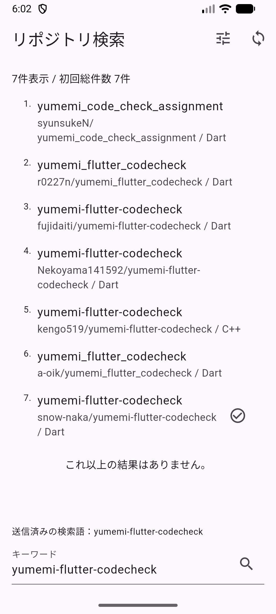
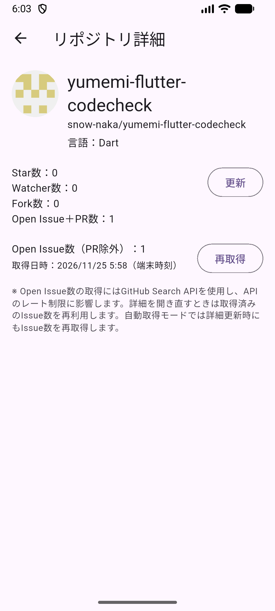
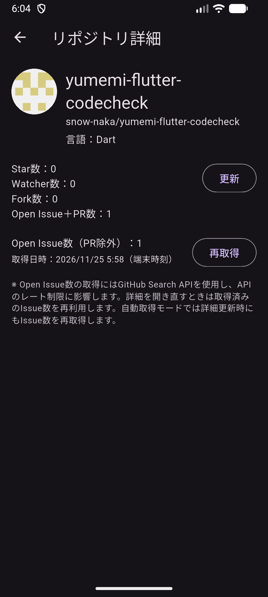
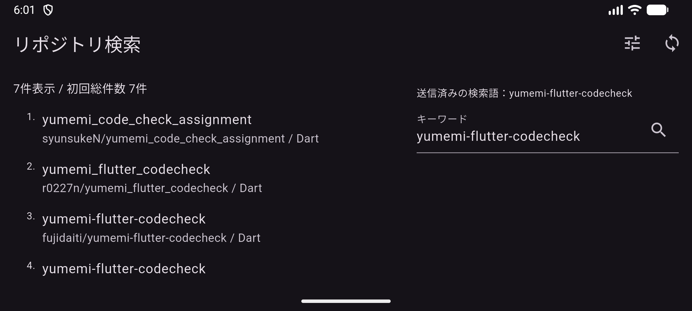

# Repo Search

GitHubの公開リポジトリをキーワードで検索し、検索結果からリポジトリの詳細情報を確認できるFlutterアプリです。

[ゆめみ Flutter エンジニアコードチェック課題](https://github.com/yumemi-inc/flutter-engineer-codecheck)への自主的な取り組みとして開発しました。Flutter未経験からの学習も兼ね、AIを活用しながら設計、実装、テスト、レビューを進め、変更理由と検証結果を追える形で開発過程を記録しています。

- アプリバージョン：`1.0.0+1`
- 開発環境：Flutter 3.50.1 stable / Dart 3.14.0 / Riverpod 3.5.0
- 開発中の最終ローカル検証：静的解析で問題なし、全350テスト成功、Android Release APK生成成功
- 動作確認：Androidエミュレーター。物理Android端末およびiOSのビルド・実行は未検証

本READMEは2026-11-25の文書整理時点の説明です。アプリ本体の基準は `8fd463c70b6a86c774c01dda9fd51f2152ca6af0`（外観改善PR #16マージ後、最終総合レビュー対象）です。予定していた機能の実装は完了し、最終文書整理・配布準備を進めています。自主レビューの結果は、企業による採点・合格判定とは区別します。

詳細な技術仕様は [現行設計書](docs/architecture.md)、開発環境と再現手順は [開発環境](docs/environment.md)、AIの利用範囲と判断の経緯は [AI利用記録](docs/ai-notes.md) に記載しています。

## 1. 主な機能

### 検索・一覧

- キーワードによるリポジトリ検索、結果一覧、0件・不完全な検索結果の表示。
- 30件ずつのページ取得、追加読み込み、失敗時の再試行、キャンセル。
- 追加読み込み時のIDによる重複排除、連番表示、取得済み件数と初回総件数の区別。
- 詳細画面から戻ったときの入力内容・検索結果・スクロール状態の保持。
- 閲覧済みリポジトリの識別表示。

### リポジトリ詳細

| 表示項目 | 内容・取得元 |
| --- | --- |
| リポジトリ名・フルネーム | `name`、ownerとname |
| オーナーアイコン | `owner.avatar_url`（不正URL・読み込み中・取得失敗時は代替表示） |
| プロジェクト言語 | `language`（未指定を区別） |
| Star数 | `stargazers_count` |
| Watcher数 | 詳細APIの `subscribers_count` |
| Fork数 | `forks_count` |
| Open Issue＋PR数 | `open_issues_count` |
| Open Issue数（PR除外） | Issue検索APIの `total_count`、取得日時 |

選択したリポジトリの概要を先に表示し、詳細取得成功後に詳細応答の情報へ更新します。詳細更新とIssue数取得をそれぞれ操作でき、取得失敗時には再試行できます。

### 自主的な追加機能・改善

| 機能 | 内容 |
| --- | --- |
| 検索欄の配置 | 上下を選択可能。横長画面では左右に切り替え、設定を保存 |
| レスポンシブ表示 | 画面幅・文字倍率に応じた配置、横画面のキーボード表示時の入力優先 |
| 長い検索語 | 送信済み検索語を最大2行で表示し、タップで全文を確認 |
| Issue取得方式 | 自動・手動を選択可能。設定を保存 |
| 多言語 | 日本語・英語。端末の優先言語に基づくFlutter標準のロケール解決。該当言語がなければ英語 |
| ダークモード | 端末のテーマ設定に追従 |
| アクセシビリティ | 操作対象が分かるSemanticsラベル・Tooltipなど |
| API通信制御 | 要求キュー、タイムアウト、レート制限管理、古い応答の破棄 |
| 開発用診断 | Debugビルド専用のAPI通信インスペクター |
| アプリ外観 | 表示名 Repo Search、独自アイコン、Android 8.0以降のAdaptive Icon |

公式課題の必須機能と、自主的な追加仕様・評価項目を区別しています。アプリ内でGitHubへの書き込みや認証トークンの管理は行いません。

### スクリーンショット

GitHub Actionsで生成したAndroid Release版の実際の動作画面。
本リポジトリを検索・表示した例を掲載する。

<p align="center">
  
  
  
</p>

<p align="center">
  検索結果一覧 ／ リポジトリ詳細 ／ ダークモード
</p>

<p align="center">
  
</p>

<p align="center">
  横画面での検索結果と検索欄の左右配置
</p>

画像内の検索結果・各種件数は撮影時点の情報であり、
現在のGitHub上の情報とは異なる場合がある。

## 2. 動作環境・使用技術

| 項目 | 開発・検証時の構成 |
| --- | --- |
| Flutter / Dart | 3.50.1 stable / 3.14.0 |
| IDE | Visual Studio Code 1.147.0 |
| 開発環境 | Windows + WSL2（Ubuntu 24.04） |
| Android | minSdk 24、targetSdk / compileSdk 36 |
| Java / Gradle | Java 17、Gradle Wrapper 9.5.0 |
| Android動作確認 | Android 17（API 37）、x86_64エミュレーター |
| iOS | Deployment Target 15.0（設定のみ確認、動作未検証） |
| 状態管理 | `flutter_riverpod` 3.5.0 |
| UI | `material_ui` 1.11.1（Material Design） |
| 通信 | `http` 1.6.0 |
| 設定保存 | `shared_preferences` 2.5.6 |
| ローカライズ | Flutter標準 `gen-l10n`、`flutter_localizations`、`intl` 0.20.3 |

VS CodeはFlutter・DartとWSLを利用する開発構成に対応するため使用しました。依存パッケージは `pubspec.lock` に解決済みの版を記録しています。直接依存・開発用依存・SDK設定の詳細は [開発環境](docs/environment.md) を参照してください。

Windows版Dartの起動がアプリケーション制御ポリシーで拒否されたため、開発中はセキュリティ設定を変更せず、WSLで編集・解析・テスト・ビルドを行い、WindowsのAndroidエミュレーターで動作を確認しました。第三者がこの構成をそのまま再現する必要はありません。

## 3. 起動方法

Flutter 3.50.1、Android SDK、Java 17およびAndroidエミュレーターまたは端末を用意します。SDKの導入は [Flutter公式のセットアップ手順](https://docs.flutter.dev/get-started/install) を参照してください。

リポジトリを取得し、`pubspec.yaml` があるプロジェクトルートで実行します。

```bash
flutter --version
flutter doctor -v
flutter pub get --enforce-lockfile
flutter devices
flutter run -d emulator-5554
```

最後の `emulator-5554` は例です。実際に表示された端末IDに置き換えてください。通常起動ではFakeではなくGitHub REST APIと通信します。ネットワーク接続が必要ですが、GitHubアカウントや認証トークンの設定は不要です。

Windows + WSL固有のSDK選択、ADB接続、ライセンスの扱い、環境構築時の検証記録は [開発環境](docs/environment.md) に記載しています。

## 4. 操作方法

1. 検索欄にキーワード（例：`flutter`）を入力し、検索アイコンまたはキーボードの検索操作で送信します。入力中の自動検索は行いません。
2. 一覧からリポジトリを選択すると詳細画面が開き、選択した項目が閲覧済みになります。次ページがある場合は一覧末尾の「もっと読み込む」を使用できます。
3. 詳細画面では「更新」で詳細情報を再取得できます。Open Issue数（PR除外）は自動取得が初期設定で、確認済みの詳細情報をもとに取得します。「取得」「再取得」「再試行」による手動操作もできます。
4. 戻る操作で元の一覧に復帰します。戻るだけでは再検索しません。検索欄の配置とIssue取得方式は、検索画面上部のメニューから変更できます。

### Issue数取得方式

Core APIの `open_issues_count` にはPull Requestが含まれるため、PRを除いたOpen Issue数は別途Search APIで取得します。課題のIssue数表示については、PRを除いた未解決（Open）の件数を表示するという解釈を採用しました。Closedを含む全Issue数ではありません。

| 操作 | 自動取得（初期設定） | 手動取得 |
| --- | --- | --- |
| 詳細を開く | 詳細取得成功後、キャッシュがなければ取得 | 利用者の操作を待つ |
| キャッシュがある詳細を開く | キャッシュを再利用 | キャッシュを再利用 |
| 詳細を明示的に更新 | 詳細成功後、Issue数も再取得 | Issue数は自動更新しない |
| Issue取得ボタン | 利用可能 | 利用可能 |

Issue検索は通常のリポジトリ検索とSearch APIの利用枠を共有します。API消費を抑えたい場合は手動取得を選択できます。Issue数は取得日時とともにアプリ起動中だけ保持し、再取得に失敗した場合は前回の取得値を維持します。未取得や不完全な応答を0件として扱いません。

## 5. 設計上の特徴

```text
検索画面 ── 画面遷移 ── 詳細画面
   │                       │
検索Controller          詳細Provider・Issue取得処理
   │                       │
   └─ GitHubRepositoryGateway ─┘
                │
       通常：HTTP Gateway → GitHub REST API
       テスト：Fake Gatewayなどに差し替え
```

画面、状態管理、データ取得を分離しています。RiverpodのProviderで共通のGatewayを提供し、テストでは依存先を差し替えられる構成としました。責務が重複する層を必要性なく追加しない方針です。

### 検索状態と非同期処理

- NotifierとAsyncNotifierの3方式を比較試作し、今回の明示的な検索操作と状態遷移に適した `Notifier<SearchState>` を採用しました。
- 検索全体の5状態と追加読み込みの4状態を型で表現し、追加読み込みに失敗しても既存一覧を保持します。
- 要求の世代番号と生存状態によって古い応答を識別します。未送信要求の取消と、送信済み要求の結果を採用しない処理を分けています。
- 想定外例外を通信失敗と混同せず、再検索・再試行できる失敗状態へ移行します。

### 詳細情報とIssue数の取得

GitHubの `watchers_count` を実際のWatcher数として使用せず、詳細APIの `subscribers_count` を使用します。詳細は開くたびにCore APIから取得し、IDを照合します。試作した詳細情報のLRUキャッシュは、通信削減効果と整合性管理・競合対策の負担を比較して廃止しました。

Issue数は詳細情報に付随する情報であり、並列取得の効果とSearch APIの利用制限を考慮して詳細取得から分離しています。自動・手動の取得処理を共通化し、Issue数だけID単位でキャッシュします。詳細更新とIssue取得の排他制御、画面離脱後のキャッシュ書き込み防止も行っています。

### API通信・レート制限

GitHub REST APIを `http` パッケージで直接呼び出します。GitHub API専用SDKには依存していません。

| 操作 | API | 利用枠 |
| --- | --- | --- |
| リポジトリ検索 | `GET /search/repositories` | Search |
| リポジトリ詳細 | `GET /repos/{owner}/{repo}` | Core |
| PR除外Open Issue数 | `GET /search/issues` | Search |

通信を共通キューで直列化し、接続タイムアウト5秒、キュー登録からHTTP本文受信までの要求タイムアウト10秒を設けています。Primary制限は対象のAPI区分、Secondary制限などは共通の停止状態で扱います。サーバーから通知された制限情報を本文の受信完了前にも反映し、本文受信失敗時の情報の取りこぼしを防ぎます。HTTPエラーの分類と後続要求の送信可否を分離し、送信直前に再確認します。自動再試行による繰り返し送信は行いません。

Debugビルドでは検索画面からAPI通信インスペクターを開けます。HTTP応答、送信前の制限による拒否、応答後の送信停止など、必要な診断情報を最大20イベントまでメモリに保持します。応答本文全体や例外の原文を記録する機能ではありません。Profile / Releaseビルドでは診断の記録・表示を無効化しています。

### 利用者設定・UI

上部の検索欄が操作しづらい場合を想定し、利用者ごとの好みに応じて上下配置を選べるようにしました。一覧を分断する中段配置は採用していません。似た名前のリポジトリを意図せず繰り返し開かないよう、ID単位の閲覧済み表示も追加しました。

検索欄の配置は画面へ即時反映し、保存失敗時に元へ戻します。API通信の可否に関わるIssue取得方式は保存成功後に確定し、読み込み・保存中は自動取得を開始しません。言語・テーマの変更にはFlutter標準の仕組みを利用し、エラー情報と翻訳文言を分離しています。

状態遷移、データモデル、通信制御、設定保存の厳密な仕様、比較試作の結果や設計判断の詳細は [現行設計書](docs/architecture.md) を参照してください。

## 6. テスト・検証

### 検証方法

```bash
flutter pub get --enforce-lockfile
flutter gen-l10n
flutter analyze --no-pub
flutter test --no-pub --reporter expanded
dart format --output=none --set-exit-if-changed lib test
```

翻訳の生成コード3ファイルをGit管理しているため、クリーンなチェックアウトからの `flutter gen-l10n` 実行後は `git status --short -- lib/l10n` に意図しない変更がないことを確認します。

Unitテスト・Widgetテストに加え、Fake Gateway、Mock HTTP Client、時刻・完了タイミングを制御できる実装を使い、外部APIの状態に依存しない検証を行っています。レート制限を発生させる目的で実APIへ大量のアクセスを送ることはしていません。

### 検証実績

| 検証 | 結果・範囲 |
| --- | --- |
| 外観改善後の開発環境での静的解析 | 問題なし |
| 外観改善後の自動テスト | 全350件成功 |
| 外観改善後のAndroid Releaseビルド | 成功（52.8 MB） |
| 実API通信 | 開発中にAndroidエミュレーターで検索・追加読み込み・0件・詳細取得を確認 |
| UI・追加機能 | 開発中にAndroidエミュレーターで画面回転、文字倍率2倍の一部、日英表示、ダークモード、Issue取得方式、表示名・アイコン等を確認 |
| GitHub Actions | 開発中の品質検証・Androidビルド・Artifact取得とSHA-256一致確認に成功 |
| 最終総合レビュー | `8fd463c` を対象に調査。独立したDart解析で問題なし、整形67ファイル差分なし、一部の動作検証9項目成功 |
| 最終CI生成APK | 2026-11-25、mainの `d372129` から生成したAPKのSHA-256照合・署名検証・Androidエミュレーターへの新規インストールに成功。実APIによる検索・詳細表示、ライト・ダークテーマ、横画面表示を確認 |

最終総合レビューではCritical / Highの指摘や、提出前に修正が必要な機能不具合は見つからなかったとの評価を得ました。一方、READMEの現況との不一致と、Git履歴に含まれるメールアドレスの公開可否について確認事項がありました。
前者は現行仕様と開発履歴を区別した文書整理によって対応しました。後者は公開範囲に関わる確認事項であり、過去のGit履歴の書き換えは行っていません。

独立レビュー環境ではWSLプロセス起動が拒否されたため、Flutterによる全350テスト、端末操作、Releaseビルドは独立再実行していません。これらの結果は開発環境での検証報告に基づきます。
2026-11-25に、mainの最終配布候補コミットからCIで生成したAPKを取得し、SHA-256照合、署名検証、Androidエミュレーターへの新規インストールと動作確認を行いました。検証対象と結果の詳細は「7. CI・検証用APK」に記載しています。

テスト件数を品質そのものの指標とはせず、重要な仕様や失敗時の挙動を検証することを重視しています。個別の検証内容と各時点の結果は [現行設計書](docs/architecture.md)・[開発環境](docs/environment.md)・[AI利用記録](docs/ai-notes.md) に残しています。

## 7. CI・検証用APK

[GitHub ActionsのWorkflow](.github/workflows/flutter.yml) ではFlutter 3.50.1 stableを指定し、lockfileによる依存取得、翻訳生成差分検査、静的解析、全自動テスト、整形チェックを実行します。mainへのPushとmain向けPRでは品質検証に続いてAndroid Release APKを生成し、featureブランチへのPushでは品質検証のみを実行します。

### ローカルでのAndroid Releaseビルド

```bash
flutter pub get --enforce-lockfile
flutter build apk --release --no-pub
```

出力先：`build/app/outputs/flutter-apk/app-release.apk`

### CIの成果物

成功したAndroidビルドのArtifactsから `app-release.apk` と `SHA256SUMS.txt` を取得できます。保存期間は14日間です。取得できるかどうかはリポジトリへのアクセス権と各Runの保存状況によります。

ZIPを展開したディレクトリで、次のコマンドによりファイルの一致を確認できます。

```bash
sha256sum -c SHA256SUMS.txt
```

Windows PowerShellでは `Get-FileHash .\app-release.apk -Algorithm SHA256` の結果とチェックサムを比較します。チェックサムの一致は独立した署名による真正性の証明ではありません。

APKはDebug署名鍵を使用した検証用Releaseビルドであり、正式なストア配布用ではありません。異なる署名鍵で生成したAPKは既存アプリへ上書きインストールできない場合があります。アンインストールを行う場合は保存済み設定などが消えることに注意してください。

GitHub Releasesでの最終APK公開は準備中です。最終配布物は対象コミット・CI結果・チェックサム・実際の動作確認を確定してから扱います。

### 最終検証用APK（2026-11-25）

PR #17のマージ後にmainのGitHub Actionsで生成されたAndroid Release APKを最終配布候補とし、ダウンロードしたファイル自体を検証しました。

| 項目 | 確認結果 |
| --- | --- |
| 生成元コミット | `d37212963bc2b7638506d89abc52725fceb46cd2` |
| Flutter | 3.50.1 stable |
| ビルド種別 | Release |
| アプリ表示名 | Repo Search |
| Application ID | `com.example.yumemi_app` |
| バージョン | 1.0.0+1 |
| ファイルサイズ | 52,765,281 bytes |
| Min SDK | API 24 |
| Target SDK | API 36 |
| Compile SDK | API 36 |
| 対応ABI | arm64-v8a、armeabi-v7a、x86_64 |
| 要求権限 | `android.permission.INTERNET` |
| 署名検証 | 成功（APK Signature Scheme v2） |
| 署名証明書 | Android Debug |
| 署名鍵 | RSA 2048 bit |

**APKのSHA-256**

```text
86502d5660a545edaa742d3474bd991cd0839727a85b120d68c4b1f71c2e5fbe
```

**署名証明書のSHA-256**

```text
eb7106b7497fdb435ced03b8a1d706628934f83998d2b5b87dcfa571c6fcd260
```

CIが生成したチェックサムとダウンロードしたAPKのSHA-256が一致することを確認しました。これはファイルの一致確認であり、配布元の真正性やアプリの安全性全体を保証するものではありません。

開発環境で使用していた署名鍵とは異なっていたため、Androidエミュレーター上の既存アプリをアンインストールし、CI生成APKを新規インストールしました。

開発者による動作確認では特段の問題は報告されていません。掲載するスクリーンショットは、このAPKで実際にGitHub APIを使用して検索・詳細表示した画面です。

なお、Debug署名鍵を使用した検証用APKであり、正式な製品配布用の署名ではありません。別のCI実行や開発環境で生成したAPKとは署名鍵が異なる場合があり、既存アプリへの上書きインストールができない可能性があります。

検証対象のAPKと生成元コミットの対応関係を維持するため、その後の文書・スクリーンショットのみの更新とは区別して管理します。

## 8. 既知の制約・未対応事項

| 分野 | 制約・未検証の内容 |
| --- | --- |
| 検索 | GitHub Search APIの最大1,000件の取得上限。検索中のデータ変動により、ID重複排除だけでは欠落を完全に防げない |
| Issue数 | Search APIの利用枠を共有。取得済み件数の鮮度は取得日時で確認する。Coreでの確認後に改名・旧名再利用が起こるまれな場合には、別リポジトリのIssue数を取得する可能性が残る |
| 通信 | 送信済み要求の利用者キャンセルによる通信中断は保証しない。停止期限の経過はGitHub側の制限解除を保証しない |
| 状態保持 | 検索欄の配置・Issue取得方式のみ永続化。検索状態、閲覧済み情報、Issue数キャッシュはアプリ再起動後に復元しない |
| UI | 回転時に閲覧位置がずれる場合がある。小さい縦画面で文字倍率が高くキーボードを開いた場合の操作性は、ソースレビュー上の指摘であり再現未確認 |
| アクセシビリティ・多言語 | 全画面のTalkBack / VoiceOver操作、すべての画面幅・文字倍率・言語の組み合わせは未検証 |
| 画像 | 代替表示のテストは実施。実際の画像通信失敗から表示切り替えまでの統合検証は未実施 |
| 対象OS | 物理Android端末・iOSは未検証。iOS動作検証環境がなく、起動画面の白背景やストア用の言語メタデータは将来の確認事項 |
| 配布 | 正式なストア署名・ストア公開・Web等の別プラットフォーム向け配備は対象外。最終APKの配布条件を別途確認する |

詳細情報のLRUキャッシュと詳細セクションの並べ替えは試作・検討後に不採用としました。アプリ内の言語・テーマ選択機能や独自アニメーションの追加も行っていません。これらは未完成の必須機能ではなく、今回の開発範囲や効果・コストを考慮した判断です。詳しい技術的な制約と改善候補は [現行設計書](docs/architecture.md) を参照してください。

## 9. AI活用と開発過程

まず全体をFake Gatewayによる軽量なスケルトンとして作り、機能をタスクとして分けて実通信、UI/UX、任意機能を追加しました。学習を兼ねて重要な設計判断と実装・検証結果を追うことを意識しています。ただし、振り返りとして、従来のAIとの進め方の影響もあり、実際には工程を細かく分けすぎた面があります。

| 利用ツール | 主な役割 |
| --- | --- |
| ChatGPT（通常チャット） | 設計相談、実装・テスト案、結果分析、文書整理 |
| ChatGPT（Work） | 実装・コード調査、比較試作の評価、独立コードレビュー |
| Codex | 初期資料・環境構築、スケルトン実装、検証 |
| Claude | データ構造・全体設計に対する別の技術的視点からのレビュー |

開発者が仕様、採否、作業範囲を判断し、開発環境での実行結果を確認するなど、段階に応じてAIと作業を分担しました。設計・実装と同じ前提にとらわれないよう、レビューは原則として別のAIまたは別の会話・作業枠で行っています。指摘をそのまま修正要求とせず、発生可能性、影響、既存の検証、実装・保守コストを比較して対応を判断しました。

| 開発段階 | 内容 |
| --- | --- |
| Phase 0 | 環境構築、Dart・Riverpodの基礎確認 |
| Phase 1 | Fake Gatewayによる検索・詳細・画面遷移、最小CI、検索状態管理の比較試作と統合 |
| Phase 2 | GitHub REST APIとの実通信、レート制限、診断、画像・Issue数取得 |
| Phase 3 | UI/UX、レスポンシブ表示、多言語、ダークモード、SDK・CI整備、Issue取得方式、アプリ外観、最終レビュー・文書・配布準備 |

変更は作業ブランチとPRで管理し、コミットは原則として一つの目的ごとに、コードと対応するテストを組にして記録しました。[PRテンプレート](.github/pull_request_template.md) の目的・変更内容と理由・検証・AI利用に沿って説明を残しています。未実行の検証は確認済みとせず、認証情報をコミットしない方針です。

比較試作、レビュー指摘、修正や見送りの理由、AIと開発者の作業範囲は [AI利用記録](docs/ai-notes.md) およびGit履歴・PRを参照してください。

## 10. 関連資料

| 資料 | 内容 |
| --- | --- |
| [現行設計書](docs/architecture.md) | 現行仕様、状態遷移、通信制御、責務分担、テスト設計、採否の理由 |
| [開発環境](docs/environment.md) | SDK、依存関係、起動・ビルド手順、環境構築時の履歴 |
| [AI利用記録](docs/ai-notes.md) | AIの利用範囲、開発者の判断、比較試作、レビュー、検証履歴 |

### 初期設計・段階別の検証履歴

以下は開発当時の記録です。そこに記載された未実装・未決定事項は、現在の未対応事項とは限りません。現行仕様は本READMEと現行設計書を参照してください。

| 資料 | 内容 |
| --- | --- |
| [実装構成・責務一覧](docs/implementation-structure-draft.md) | 初期スケルトンの構成案と採用方針 |
| [Riverpod・API整理メモ](docs/riverpod-api-notes.md) | 初期の技術調査・外部仕様・設計案 |
| [Riverpod導入と基礎確認](docs/riverpod-basics.md) | 基礎APIと依存先の差し替えの検証 |
| [Fake Gateway](docs/fake-gateway.md) | 初期データモデル・取得窓口の検証 |
| [検索スケルトン](docs/search-skeleton.md) | 初期検索実装・当時の課題 |
| [詳細スケルトン](docs/detail-skeleton.md) | 初期詳細取得・画面遷移の検証 |
| [スケルトン最終検証](docs/skeleton-final-verification.md) | Phase 1のAndroid操作、CI、完了条件との照合 |

### 主要ファイル

- [`lib/`](lib/)：アプリ本体（状態管理、画面、通信、翻訳、診断）。`lib/spikes/` は比較試作の記録であり、通常起動の実装とは区別します。
- [`test/`](test/)：自動テスト。
- [`design/`](design/)：アイコン原本 `app-icon.svg` とAndroid・iOS用PNG生成スクリプト `generate_icons.py`。Android Adaptive IconのVectorDrawableは別に管理しています。
- [CI設定](.github/workflows/flutter.yml)：品質検証とAndroidビルド。

### ライセンス・配布について

利用するサードパーティーライブラリのライセンスに従います。

最終検証用Android APKに含まれるFlutterの `NOTICES.Z` とAndroidX関連の4つのライセンスファイルを抽出し、`THIRD_PARTY_NOTICES.txt` にまとめました。

この抽出によって全依存関係の再配布条件の充足を保証するものではありません。個別の再配布条件については配布前の確認事項とします。

アプリ自体の公開ライセンスは現時点では設定していません。
