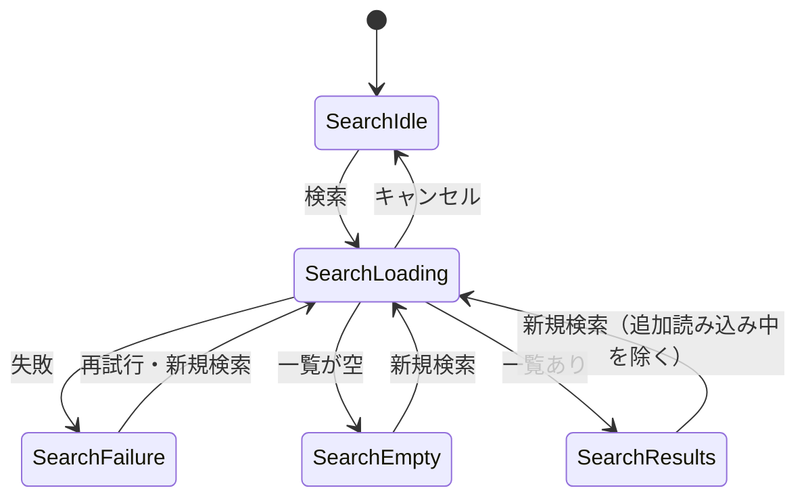

# Repo Search — 現行仕様・技術設計

- 対象：ゆめみ Flutter エンジニアコードチェック課題への自主的な取り組み
- 基準日：2026-11-25
- 基準となる実装：`main` の `8fd463c70b6a86c774c01dda9fd51f2152ca6af0`（外観改善 PR #16 マージ後、最終総合レビュー対象）
- 確認環境：Flutter 3.50.1 stable / Dart 3.14.0 / Riverpod 3.5.0

本書は、現在の実装の構成、動作、設計上の理由と制約を説明する。初期の設計・技術調査・試作の記録は別資料に残し、当時の候補や未決定事項を現行仕様とは扱わない。公式課題の要求と、自主的に追加した仕様も区別する。

アプリの利用方法と最終検証結果は [README](../README.md)、環境の詳細は [開発環境](environment.md)、判断の経緯と各時点の実行結果は [AI利用記録](ai-notes.md) を参照する。本書の整理は共有された実装コード、開発資料、実行結果、最終総合レビューおよび開発者による補足説明に基づく。最終総合レビュー以降に実装やテストを再実行した記録ではない。

## 1. 設計の目的・基本方針

公開リポジトリをキーワードで検索し、結果一覧から選択したリポジトリの詳細を確認できるようにする。公式課題の必須表示項目を優先し、検索結果の閲覧、通信失敗からの復帰、限られたAPI利用枠での操作性を改善する。

- 画面、状態管理、データ取得の責務を分ける。データ取得の共通契約を設け、役割が重複するRepository・Service・UseCaseなどを必要性なく追加しない。
- 取得中・成功・失敗・未取得を区別する。正常な0件を失敗の代用にせず、未取得の数値を0と表示しない。
- 外部APIの結果を検証してから採用する。利用者が操作を取り消した場合や対象が変わった場合に、古い応答で現在の画面や保存済みの値を誤って更新しない。
- Fakeから実通信へ段階的に移行し、状態管理と画面のテストを実際の通信に依存させない。
- GitHubの利用制限を尊重し、通常の操作やテストのために意図的な大量アクセスを行わない。
- 小規模な読み取り専用アプリとして、対策の効果、影響範囲、実装・検証・保守コストを比較する。理論上の競合をすべて排除することや、テスト件数を増やすこと自体を目的にしない。

## 2. 全体構成・責務分担

```text
main() / ProviderScope
  └─ MyApp（MaterialApp、テーマ、ローカライズ）
       └─ SearchScreen ── 画面遷移 ── RepositoryDetailScreen
             │                                 │
             ├─ SearchController               ├─ 詳細取得Provider
             │   / SearchState                 └─ 詳細更新・Issue取得処理
             │                                 │
             └───── GitHubRepositoryGateway ───┘
                             │
                   通常起動：HTTP Gateway
                   テスト時：Fake等に差し替え
                             │
                   HTTP Gateway → GitHub REST API
                   （共通要求キュー、レート制限、診断）
```

上図は主要なデータ取得経路を示す。検索欄の配置、閲覧済み情報、Issue取得方式、Issue数キャッシュ、診断履歴はそれぞれ別の責務として保持する。オーナー画像は詳細画面の画像Widgetから取得し、REST APIのGatewayには含めない。

### 2.1 ファイル構成

| 配置 | 責務 |
| --- | --- |
| [`lib/main.dart`](../lib/main.dart) | アプリの起動、ProviderScope、テーマ、ローカライズの組み立て |
| [`lib/providers.dart`](../lib/providers.dart) | HTTPクライアント、Gateway、診断履歴、Issue数キャッシュの共通Provider |
| [`lib/models/`](../lib/models/) | リポジトリ・検索ページ・失敗情報などのデータ型 |
| [`lib/data/`](../lib/data/) | Gatewayの契約、HTTP実装、Fake、レート制限、Issue数取得用の処理 |
| [`lib/features/search/`](../lib/features/search/) | 検索制御・状態型・画面・検索欄の配置・閲覧済み情報・想定外エラーの報告 |
| [`lib/features/detail/`](../lib/features/detail/) | 詳細取得・詳細画面・Issue数取得・取得方式設定・キャッシュ |
| [`lib/devtools/`](../lib/devtools/) | 開発用API通信インスペクター |
| [`lib/l10n/`](../lib/l10n/) | 日英翻訳リソース、生成コード、エラー文言・日時の表示処理 |
| [`lib/spikes/`](../lib/spikes/) | 比較試作のコード（mainに保持されるNotifier版）。通常起動の実装とは区別する |
| [`test/`](../test/) | 各責務の自動テストと比較試作の検証 |
| [`design/`](../design/) | アイコンのSVG原本とPNG生成スクリプト |

### 2.2 Riverpodによる組み立て

`main()`で`MyApp`の外側に`ProviderScope`を配置する。テストでは外側のScopeからProviderをoverrideできる。Riverpodのコード生成は利用しない。

| Provider | 役割 |
| --- | --- |
| `githubHttpClientProvider` | `HttpClient`（接続タイムアウト5秒）を`IOClient`で包み、破棄時にクライアントを閉じる |
| `githubRepositoryGatewayProvider` | 同じHTTP Gatewayを検索、詳細、Issue数取得で共有する。レート制限管理を画面ごとに分散させない |
| `apiDiagnosticsProvider` | 最大20イベントのメモリ上の診断履歴を提供し、破棄時に解放する |
| `openIssueCountCacheProvider` | Issue数と取得日時のキャッシュを提供し、破棄時に消去する |
| `searchControllerProvider` | `Notifier<SearchState>`による検索状態と操作の管理 |
| `repositoryDetailProvider` | `FutureProvider.autoDispose.family`による対象ごとの詳細取得 |
| `viewedRepositoryProvider` | `Notifier<Set<int>>`による閲覧済みIDの管理 |
| `searchPanelPositionStoreProvider` | 検索欄配置の読み書きの窓口 |
| `issueCountFetchModeProvider` / `issueCountFetchModeStoreProvider` | `AsyncNotifier`による取得方式の共有状態と、設定の読み書きの窓口 |
| `unexpectedErrorReporterProvider` | 想定外の検索エラーの報告先を提供する |

Scopeの自動再試行を無効にし、詳細ProviderとIssue取得方式Providerにも自動再試行を無効にする設定を持たせている。通信失敗後に自動的に要求を繰り返す方式ではなく、利用者の操作による再試行を基本とする。

## 3. データモデルと取得契約

### 3.1 主なデータモデル

| 型 | 内容と用途 |
| --- | --- |
| `RepositoryKey` | `id`、`owner`、`name`。3項目の値で等価性とhashCodeを定義する |
| `RepositorySummary` | 識別情報、オーナー画像URL、言語（nullable）、Star数、Fork数、Open Issue＋PR数。名前とフルネームはキーから得る |
| `RepositoryDetail` | 概要とWatcher数を保持する。概要を継承せず、構成要素として持つ |
| `SearchPage` | 1ページ分の一覧、総件数、不完全フラグ、ページ番号・サイズ、次ページ情報 |
| `PageNavigation` | `NextPage` または `PageEnd`。終了理由は通常終了・GitHubの取得上限到達を区別する |
| `ApiFailure` | API失敗の基本分類、任意の具体的な原因、HTTPステータス、再要求の目安となる日時 |
| `SearchProblem` | API由来の失敗と想定外の失敗を区別する検索画面用の情報 |
| `OpenIssueCountEntry` | PR除外Open Issue数と取得日時 |

`RepositoryKey`はowner/nameを含む詳細取得のキーとして使う。一方、閲覧済み情報とIssue数キャッシュはID単位で識別する。同一IDでも名前が変わる可能性があるため、用途に応じて等価性を使い分ける。

`SearchPage`は一覧を変更不可にする。ページ番号1以上、ページサイズ1〜100、総件数0以上、ページ内件数がページサイズ以下、次ページ番号が現在のページ＋1という条件を検証する。外部応答の検証と併せ、利用側が扱える形式のデータを渡す。

### 3.2 Gatewayの契約

[`GitHubRepositoryGateway`](../lib/data/github_repository_gateway.dart) の取得操作は次の3種類である。

| 操作 | 入力 | 成功時 |
| --- | --- | --- |
| `searchRepositories` | 検索語、page（既定1）、perPage（既定30）、任意のキャンセル判定 | `Future<SearchPage>` |
| `getRepository` | `RepositoryKey` | `Future<RepositoryDetail>` |
| `getOpenIssueCount` | `RepositoryKey`、任意のキャンセル判定 | `Future<int>` |

想定したAPI失敗は`ApiFailure`で伝える。キュー内で不要になった要求の送信前キャンセルは`QueuedRequestCanceled`で表現し、通常のAPI失敗と区別する。HTTPやJSONの詳細はGateway側に置き、画面で外部応答を直接処理しない。実際のキャンセル条件と限界は第5・6・8章を参照。

## 4. 状態の管理場所と生存期間

| 情報 | 管理場所 | 保持・破棄 |
| --- | --- | --- |
| 編集中の検索語 | SearchScreenの`TextEditingController` | 検索画面の生存中。詳細から戻っても維持 |
| 送信済み検索語・結果・検索状態 | SearchController | アプリ内の検索状態。次の検索、初回検索のキャンセル等で更新 |
| 検索一覧のスクロール位置 | SearchScreenの`ScrollController` | 検索画面の生存中。新規検索では先頭へ移動 |
| 選択した概要 | 詳細画面への引数 | その詳細画面の生存中 |
| 詳細取得状態 | 詳細Provider | 購読終了後に自動破棄。開くたびに新規取得 |
| Issue取得中・エラー・画面表示用の件数と日時 | `_RepositoryDetailActions`のState | その詳細画面の生存中 |
| Issue数キャッシュ | `OpenIssueCountCache` | ID単位、アプリ起動中のみ |
| 閲覧済みID | ViewedRepositoryController | アプリ起動中のみ |
| 検索欄の配置 | SearchScreenと設定Store | 端末内に保存し再起動時に復元 |
| Issue数取得方式 | IssueCountFetchModeNotifierと設定Store | 端末内に保存し再起動時に復元 |
| APIの送信停止状態 | 共有HTTP GatewayのPolicy/Coordinator | Gatewayの生存中。永続化しない |
| 診断履歴 | InMemoryApiDiagnostics | Debugビルドのメモリ上。永続化しない |

詳細画面はNavigator.pushで開き、検索画面をスタックに残す。戻るだけでは検索をやり直さない。検索状態、閲覧済みID、Issue数キャッシュなどをアプリ再起動後に復元する仕組みは設けない。

## 5. 検索・追加読み込み・キャンセル

### 5.1 状態型と初回検索

検索操作は [`SearchController`](../lib/features/search/search_controller.dart) が担当し、[`SearchState`](../lib/features/search/search_state.dart) をsealed classで定義する。独自状態をさらにAsyncValueで包む二重管理は行わない。

| 状態 | 保持情報 |
| --- | --- |
| `SearchIdle` | 未検索（queryはnull） |
| `SearchLoading` | 送信済み検索語 |
| `SearchFailure` | 検索語・失敗原因 |
| `SearchEmpty` | 検索語・初回総件数・不完全フラグ |
| `SearchResults` | 検索語・取得済みの非空一覧・初回総件数・不完全フラグ・取得済みページ・ページサイズ・追加読み込み状態 |



- 検索ボタンまたはキーボードの検索操作で開始する。入力中の自動検索は行わない。
- 前後空白を除いた検索語が空であれば、通信せず現在の検索状態を維持する。画面の入力検証とControllerの検証を組み合わせる。
- 初回検索中・追加読み込み中は新規検索を拒否する。入力の編集自体は可能。
- 送信時点の検索語を確定する。初回失敗後の再試行は、失敗した検索語を使う。編集中の入力を上書きしない。
- 新規検索では既存の結果表示を切り替え、次の一覧は先頭から表示する。画面側で新規検索の送信時にスクロールを先頭へ戻す。
- 初回取得は1ページ目、ページサイズ30。応答のページ番号・サイズが要求と一致しなければ採用しない。
- 初回の一覧が空でも、総件数や不完全性によって、該当なし・表示できる結果がない・不完全な結果を区別する。

### 5.2 追加読み込み

`SearchResults`の内部に次の4状態を持ち、追加読み込みに失敗しても取得済み一覧を保持できるようにする。

| 状態 | 操作・遷移 |
| --- | --- |
| `LoadMoreAvailable` | 次ページ取得が可能。取得開始でLoadingへ |
| `LoadMoreLoading` | 実行中。成功でAvailableまたはEnd、失敗でFailure、キャンセルでAvailableへ |
| `LoadMoreFailure` | 既存一覧を維持し、未取得の同じページを再試行できる |
| `LoadMoreEnd` | 次ページなし。通常終了とGitHub取得上限を区別して表示する |

次の要求は`loadedPage + 1`、同じページサイズを使用する。応答のページ情報を照合し、既存一覧および新しい追加分のIDの重複を除いて追加する。すでに存在するIDの項目を更新する処理ではない。

初回検索の総件数を維持し、表示済み件数と区別する。`incompleteResults`は取得したページ間でORを取り、途中の不完全な結果を後続の正常フラグで消さない。次ページの有無はGatewayの`PageNavigation`に従い、表示済み件数だけで決めない。

### 5.3 古い応答の無効化と復帰

検索要求の開始ごとに世代番号を発行し、キャンセル・Provider破棄時にも世代番号を進める。開始時のRefの`mounted`と現在の世代番号を確認し、要求が無効になっていれば成功・失敗のどちらも状態へ反映しない。同じ検索語をキャンセル後に送信し直した場合も区別できる。

```text
要求A開始（世代1）
  → キャンセル（世代2）→ 未検索へ戻る／既存一覧を保持
  → 要求B開始（世代3）
  → Aの応答：世代不一致のため破棄
  → Bの応答：有効であれば状態へ反映
```

未送信の要求についてはGatewayへキャンセル判定を渡す。送信済みの要求が必ず中断されるわけではない。

`ApiFailure`は`ApiSearchProblem`へ、Gateway呼び出し・応答処理中の想定外例外は`UnexpectedSearchProblem`へ変換する。失敗状態に移行してからReporterへ通知するため、Reporterの失敗で検索が待機状態に取り残されないようにしている。初期スケルトンで残っていた想定外例外後の復帰問題への改善であり、すべてのプログラム不具合からの復旧を保証するものではない。

## 6. 詳細取得・Issue数・キャッシュ

### 6.1 詳細取得と表示

[`repositoryDetailProvider`](../lib/features/detail/repository_detail_provider.dart) は`RepositoryKey`を引数とする`FutureProvider.autoDispose.family`。検索画面から詳細を開く際に対象Providerをinvalidateし、前回の自動破棄が完了する前の再訪でも新規取得する。検索状態は無効化しない。

HTTP Gatewayで応答IDを確認し、詳細ProviderでもIDを照合する。検索時と異なるIDの詳細は表示しない。改名等で応答のowner/nameが変わっても、同じIDとして検証できた場合はその応答を利用できる。

| 表示内容 | 取得中・失敗時 | 取得成功時 |
| --- | --- | --- |
| 名前・フルネーム・言語・画像URL | 選択時の概要 | 詳細応答の概要 |
| Star・Watcher・Fork数 | 表示しない | 詳細応答の値 |
| Open Issue＋PR数 | 選択時の概要の値 | 詳細応答の値 |
| PR除外Open Issue数・取得日時 | キャッシュがあれば復元して表示 | 取得・更新可能 |

明示的な詳細更新中も前回の詳細応答ではなく、選択時の概要へ戻す。失敗時の再試行は詳細Providerだけをinvalidateする。アプリ側の自動再試行は行わない。

### 6.2 Issue数の取得方法と選択理由

GitHubの`open_issues_count`はOpen IssueとOpen PRを含む。PRを除いたOpen Issue数と同じ値として扱わず、詳細画面で両者を区別する。課題のIssue数表示要件に対し、本アプリはPRを除いた未解決（Open）のIssue数を取得・表示するという解釈を採用した。課題がOpen/Closedの扱いまで明示しているという意味ではない。

PR除外件数のためにSearch APIを追加で使用する。開発者は次の理由から、詳細取得とIssue数取得を独立した操作とした。

- Search APIの利用回数制限が厳しく、詳細の閲覧ごとに必ず追加の検索枠を消費する方式を避けたい。
- Issue数は詳細情報に付随する情報であり、詳細情報がない状態で先に取得したり、同時並行で取得したりする利点は小さいと判断した。
- PRを含む件数と除外した件数を区別しつつ、自動取得・手動取得の両方式から同じ取得処理を使いやすくしたい。

| 操作 | 自動取得（初期設定） | 手動取得 |
| --- | --- | --- |
| 詳細を開く | 詳細取得成功後、キャッシュがなければ自動取得 | 利用者の取得操作を待つ |
| キャッシュがある詳細を開く | キャッシュを利用 | キャッシュを利用 |
| 詳細を明示的に更新 | 詳細取得成功後、キャッシュがあってもIssue数を取得 | Issue数は自動更新しない |
| Issue取得ボタン | 取得・再取得・再試行が可能 | 同左 |
| Issue取得失敗 | 自動再試行しない | 同左 |

### 6.3 自動取得の開始条件と排他制御

[`RepositoryDetailScreen`](../lib/features/detail/repository_detail_screen.dart) は取得済み詳細から確認済みの`requestKey`を渡す。`_RepositoryDetailActions`は詳細更新とIssue取得の操作、およびIssue数の画面状態を担当する。

自動取得は「詳細を開いたとき」と「明示的な詳細更新後」の2種類の契機を保持し、初回の設定読み込みや保存が終わるまで開始判定を保留する。フレーム終了後のコールバックで最新の詳細取得状態・設定を読み直し、許可された場合だけ共通の取得処理`_load()`を呼ぶ。一つの契機について開始判定を繰り返さない。手動取得が先に始まれば自動取得の予約を消費する。

詳細更新もIssue取得も、開始時に画面の生存、離脱状態、Issue取得中でないこと、確認済みキーの存在と現在の詳細Providerの状態・キーの一致を確認する。ボタンの再描画だけに依存せず、連続操作による二重実行を防ぐ。詳細取得失敗時には詳細の再試行を提供するが、未確認の名前を使って新しいIssue検索を行わない。

Issue取得時は開始時の世代番号・キーを保持する。画面からのpopが成立した時点を`PopScope`で記録することで、戻るアニメーション中でWidgetがまだ生存していても不要な要求を識別する。未送信要求を取り消す判定にこれらを使用し、完了後も生存状態・pop状態・世代・キーを確認する。画面更新前だけでなくキャッシュへ書き込む前にも同じ条件を確認する。

### 6.4 キャッシュの扱い

詳細情報全体を保持して再訪時に利用する独自LRUキャッシュは採用していない。詳細は開くたびにCore APIから取得してIDを照合する。Riverpodによる詳細取得状態の一時保持とは区別する。

[`OpenIssueCountCache`](../lib/features/detail/open_issue_count_cache.dart) はIDをキーにPR除外件数と取得日時を保持する。

| 項目 | 現行仕様 |
| --- | --- |
| 保持期間 | アプリ起動中。永続化・自動失効・件数上限は設けない |
| 保存値 | 0以上の件数とUTCの取得日時 |
| 再訪 | キャッシュがあれば取得日時とともに利用する |
| 成功 | 新しい件数と取得日時で上書きする |
| 失敗 | 前回の件数と取得日時を維持し、エラーを表示する |
| 再取得中 | 取得中の表示に切り替え、前回の取得日時は保持する |

詳細のLRUキャッシュは一度試作したが、異なるリポジトリを順に閲覧する利用を想定し、短時間で同じ詳細を繰り返し開く際のCore API削減効果よりも、改名・旧名再利用時の整合性管理や応答競合への対応コストが大きいと判断して廃止した。Issue数はSearch APIの枠を共有するため、取得日時を明示してセッション内キャッシュを残した。

## 7. 利用者設定と永続化

設定は`SharedPreferencesAsync`を使う。どちらも読み書き用インターフェースを定義し、テストから保存処理を差し替えられるようにしている。

| 項目 | 検索欄の配置 | Issue数取得方式 |
| --- | --- | --- |
| 保存キー | `layout.search_panel_position.v1` | `detail.issue_count_fetch_mode.v1` |
| 保存値 | `top` / `bottom` | `automatic` / `manual` |
| 未保存 | 上配置 | 自動取得 |
| 未知の値 | 上配置 | 手動取得（読み込み失敗の警告は出さない） |
| 読み込み例外 | 上配置を維持 | 手動取得と読み込み失敗状態 |
| 変更反映 | 画面へ先に反映 | 保存成功後に確定 |
| 保存失敗 | 変更前の配置へ戻し通知 | 変更前の設定状態を維持し通知 |
| 管理 | SearchScreenのローカル状態 | AsyncNotifierによる検索・詳細間の共有状態 |

検索欄の配置は画面の見た目に関する設定であり、利用者の操作にすぐ反応する。初期読み込みが遅れても利用者が変更した配置を上書きしない。保存中は追加の設定変更を受け付けない。

Issue取得方式は自動通信の可否に関わるため、保存中は変更前の設定値を維持しつつ自動取得を抑止する。設定の読み込み・保存中はメニューを無効にする。設定の読み込みに失敗した場合は手動取得とし、警告アイコンと説明を表示する。正常時に同じ設定値を選ぶと保存を省略するが、読み込み失敗状態では同じ値の選択でも保存を試み、成功すれば失敗状態を解消する。保存完了時に開始時のRefが有効であることも確認する。

取得方式を変更する処理自体はGitHubへ要求を送らない。詳細表示・更新の自動取得判定が確定済みの設定を参照する。

## 8. HTTP通信・要求キュー

### 8.1 APIの利用方法

通常起動では [`HttpGitHubRepositoryGateway`](../lib/data/http_github_repository_gateway.dart) が`package:http`を使用してGitHub REST APIを呼び出す。GitHub専用SDKや認証トークンは使用しない。対象は公開情報で、更新・削除などの書き込み要求は送信しない。

| 取得内容 | エンドポイント | リソース区分 | 主な要求条件 |
| --- | --- | --- | --- |
| リポジトリ検索 | `GET /search/repositories` | Search | `q`、`page`、`per_page`。sort/orderは指定しない |
| リポジトリ詳細 | `GET /repos/{owner}/{repo}` | Core | 選択したリポジトリのowner/name |
| PR除外Open Issue数 | `GET /search/issues` | Search | `q=repo:OWNER/REPO is:issue is:open`、`per_page=1` |

共通の要求先は`https://api.github.com`。クエリは`Uri.https`、詳細のパスは`Uri`の`pathSegments`を用いて構築する。文字列を生のURLに連結して要求する方式は採らない。送信するヘッダーは以下のとおり。

```http
Accept: application/vnd.github+json
X-GitHub-Api-Version: 2026-03-10
User-Agent: yumemi-flutter-codecheck
```

Authorizationは設定しない。オーナー画像は別経路（第11章）で取得する。Gateway独自のリダイレクト追従先の検証・制御は実装していない。

### 8.2 共通キュー・タイムアウト・送信前の判定

SearchとCoreで同じGateway、同じ要求キューを使用する。各要求のHTTP送信と本文受信・制限状態の反映を直列化することで、先行応答から得た制限情報を後続の送信判定に利用できる。これは現行構成による効果であり、開発者による詳細取得とIssue取得の順序の判断（第6章）とは別の論点である。

```text
API別の要求条件・URI構築
  → 共通キューに登録（計時開始）
  → 先行要求の処理が終了するまで待機
  → 期限とキャンセルを確認
  → Guardによる送信可否判定
  → HTTP送信・ヘッダー受信
  → 観測できた制限情報の反映
  → 本文受信・残りの判定・呼び出し元へ結果を通知
  → API別のJSON検証・データ変換
```

| 設定 | 値・対象 |
| --- | --- |
| 接続タイムアウト | 5秒（Providerが生成するHttpClient） |
| 要求タイムアウト | 既定10秒（キュー登録からHTTP本文受信・応答処理まで） |
| 経過時間 | `Stopwatch`で測定し、Timerの通知と実経過時間の両方で判定 |
| 期限超過 | 呼び出し元にtimeoutを通知。送信中は`AbortableRequest`の中断を要求する |
| 未送信のキャンセル | キューから実行する直前のコールバックで確認し、通信せず終了 |

10秒にはキュー内の待機時間が含まれる。期限超過後にキューへ順番が回ってきても送信せず、Timerの通知が遅れても期限超過後の成功応答を採用しない。各APIのJSON解析は共通`_get`の結果を受け取った後で行うため、この時間制限の対象外である。

利用者によるキャンセルは、送信済み通信の中断ではなく、不要な応答を採用しないことを基本とする。タイムアウト時の中断要求も、即時の通信停止やサーバー側での未処理を保証するものではない。呼び出し元への期限超過通知と、キュー内での処理終了は必ずしも同時ではない。

レート制限で停止中の要求は解除時刻までキューで待ち続けるのではなく、Guardが送信前に失敗を通知する。自動的な再送は行わない。

### 8.3 リポジトリ検索のページング

Gatewayは空白だけの検索語、ページ番号1未満、ページサイズ1〜100以外、取得可能な最初の1,000件の範囲外となるページを拒否する。各応答の`items`がページサイズと残り取得可能件数の小さい方を超えていないことも確認する。

`Link`ヘッダーから`rel="next"`の有無を読み取り、次ページのURLをそのまま送信先に使わず、ページ番号から新しいURIを組み立てる。

| 条件 | `PageNavigation` |
| --- | --- |
| nextがあり、要求ページが1,000件上限に未到達 | `NextPage(page + 1)` |
| 要求ページが上限に到達し、応答の総件数が1,000件超 | `PageEnd(githubLimitReached)` |
| その他の取得終了 | `PageEnd(exhausted)` |

ページサイズ30の場合、取得可能範囲の最後は34ページ目の最大10件となる。この上限判定は表示済み一覧の件数ではなく、ページ番号・ページサイズと応答を基に行う。

### 8.4 リポジトリ応答の検証と変換

HTTP 200の応答をUTF-8のJSONとして解析する。検索・詳細で概要変換を共通化する。必須情報の型・値を検証し、利用しない追加フィールドは無視する。

| APIの項目 | アプリでの扱い |
| --- | --- |
| `id` | 正の整数。詳細取得では要求時のIDとの一致が必要 |
| `owner.login` / `name` | 空白だけではない文字列 |
| `owner.avatar_url` | 文字列。画像を取得する際のURLの検証は表示側で行う |
| `language` | 文字列またはnull（欠落もnullとして扱う） |
| `stargazers_count` | 0以上のStar数 |
| `forks_count` | 0以上のFork数 |
| `open_issues_count` | 0以上のOpen Issue＋PR数 |
| `subscribers_count`（詳細） | 0以上のWatcher数 |
| `total_count` / `incomplete_results` / `items`（検索） | 総件数・不完全性・一覧。型とSearchPageの条件を確認する |

`watchers_count`は実際の購読者数ではなくStar数と同じ意味の項目なので、Watcher数として利用しない。詳細応答の`subscribers_count`を採用する。

### 8.5 PR除外Open Issue数の検証

[`github_open_issue_count.dart`](../lib/data/github_open_issue_count.dart) にURI構築と件数の解析を分離している。全Issueを取得して数えるのではなく、1件を上限とする最初のページを要求して`total_count`を利用する。

採用する条件は次のとおり。

| 項目 | 条件 |
| --- | --- |
| JSON | オブジェクト |
| `total_count` | 0以上の整数 |
| `incomplete_results` | bool型のfalse |
| `items` | 配列。総件数0なら空、正数なら1件 |

不正・不完全・矛盾した応答は`invalidResponse` / `issueCountUnverified`として扱い、0件や確定値として表示しない。個別のIssueの内容や所属リポジトリIDの照合は行わない。検索インデックスの鮮度や名前再利用に伴う制約は第15章を参照。

## 9. レート制限管理

### 9.1 責務の分離

GitHubから返された情報の解析、制限判定、状態更新、送信前の確認を分ける。状態更新に用いる時刻はUTCにそろえる。

| 部品 | 責務 |
| --- | --- |
| [`GitHubRateLimitHeaders`](../lib/data/github_rate_limit_headers.dart) | HTTPヘッダーの正規化・型変換 |
| [`GitHubRateLimitEvaluator`](../lib/data/github_rate_limit_evaluator.dart) | HTTPステータス、ヘッダー、本文からの制限分類・期限候補の判定 |
| [`GitHubRateLimitCoordinator`](../lib/data/github_rate_limit_coordinator.dart) | 判定結果の反映、既定の待機期限、予防的停止、連続制限回数の管理 |
| [`GitHubRateLimitPolicy`](../lib/data/github_rate_limit_policy.dart) | リソース別・共通の停止状態を保持し、適用される最も遅い期限を返す |
| [`GitHubRateLimitGuard`](../lib/data/github_rate_limit_guard.dart) | HTTP送信直前にPolicyを確認し、制限中の要求を拒否する |

HTTPステータスのエラー分類と、後続の要求を送信してよいかの判断は独立している。例えば、404や422はレート制限による失敗でなくても、ヘッダーの残数が0なら次回の要求を予防的に停止する。

### 9.2 ヘッダーの解析

| ヘッダー | 解釈 |
| --- | --- |
| `x-ratelimit-limit` | 0以上の整数の利用枠上限 |
| `x-ratelimit-remaining` | 0以上の整数の残数 |
| `x-ratelimit-reset` | 有効範囲内のUnix epoch秒をUTCの日時に変換 |
| `retry-after` | 0以上の整数秒をDurationへ変換。HTTP日時形式には非対応 |
| `x-ratelimit-resource` | search / coreを識別する。不明な場合はnull |

ヘッダー名の大文字・小文字は区別せず、値の前後空白を除く。欠落や解釈できない値を0として扱わない。停止対象の決定には、ヘッダーのresource値ではなく、要求時にGatewayが指定したリソース区分を使用する。

### 9.3 制限の分類と停止対象

Evaluatorは403/429のみをレート制限の分類対象とし、次の優先順で判定する。本文からSecondaryを示す情報が得られる場合は、Primaryの判定より優先する。

| 条件 | 分類 | 停止対象 |
| --- | --- | --- |
| 本文がSecondary rate limit / abuse detectionを示す403または429 | `secondary` | SearchとCore共通 |
| 残数0の403または429（上記以外） | `primary` | 要求時のリソースのみ |
| 上記で分類できない429 | `unknown429` | SearchとCore共通 |
| その他の403、403/429以外 | `none` | Evaluatorによる停止なし（Coordinatorのヘッダー観測は別） |

```text
Search（リポジトリ検索・Issue数取得） ─ Search固有の停止期限 ─┐
                                                               ├─ 共通停止期限も適用
Core（リポジトリ詳細取得）           ─ Core固有の停止期限   ─┘
```

SearchのPrimary制限だけが有効なら、Coreを一律には停止しない。Secondary制限や分類できない429は安全側に判断して両方に適用する。ただし、送信が可能と判定されたことはGitHubによる受け付けを保証しない。

### 9.4 待機期限と指数バックオフ

期限候補は、残数0のときの未来のReset時刻と、正のRetry-Afterに基づく期限のうち、適用できる遅い方とする。Coordinatorは期限情報がない場合に既定値を補い、Policyは既存の期限より短い期限で上書きしない。

| 場面 | 送信制御 |
| --- | --- |
| Primaryと判定され、有効な期限候補がある | 要求時のリソースをその期限まで停止 |
| Primaryと判定され、Resetが欠落・不明で有効な期限候補がない | 1時間停止 |
| Primaryと判定され、Resetがすでに経過し有効な期限候補がない | 1分間停止 |
| Secondary / unknown429に有効な期限候補がない | 初回は1分間の共通停止 |
| 403/429に正のRetry-Afterがある | ヘッダー受信時に停止を反映。残数0ならリソース別、それ以外は共通 |
| 503に正のRetry-Afterがある | 対象リソースを停止。Secondaryと分類せず、要求自体はサーバーエラーとして扱う |
| 403・429以外の応答で残数0のヘッダーを観測 | 未来のResetまで対象リソースを停止。Reset不明なら1時間。経過済みResetだけでは新規停止を登録しない |

リソース固有の停止と共通停止が重なった場合、現在も有効な期限の最も遅いものを使用する。例えばSearch固有の停止が12:04まで、共通停止が12:07までなら、SearchとCoreの双方が12:07まで停止する（Core固有の停止がない場合）。

Secondaryまたはunknown429の連続回数を保持し、2回目以降は`60 × 2^(回数−1)`秒（最大3,600秒）の追加の停止期限を登録する。初回にサーバー指定の期限がない場合の例は、1分、2分、4分、8分、16分、32分、60分以降となる。既存期限やサーバー指定期限が長ければそれを維持する。HTTP 200の本文を最後まで受信すると連続回数をリセットする（API別のJSON検証成功とは別）。同一応答を二重にカウントしないようにする。

このバックオフは送信再許可の目安を決めるための仕組みであり、一定時間後に自動で通信を再実行する仕組みではない。

### 9.5 ヘッダーの早期観測と送信前制御

HTTP Gatewayは本文受信完了を待たずに、ヘッダー受信時点の診断情報、Retry-After、Primary残数0など判定できた停止情報を反映する。403/429は本文なしで判定できる制限を先に反映し、本文受信後に追加情報を含めて判定する。本文受信が途中で失敗しても、既に観測した停止状態を維持する。これは独立レビューで見つかった制限情報の取りこぼしへの対応である。

Guardは送信直前にPolicyを確認する。停止中なら`ApiFailure(kind: rateLimited, reason: blockedBeforeSend, retryAt: ...)`を通知する。この時点ではHTTP応答を受けていないため、HTTPステータスは設定しない。

期限不明のリソース別・共通停止を保持する仕組みもあるが、通常のEvaluatorとCoordinatorの経路は既定期限を補う。期限不明の状態を明示的に解除する処理は現行実装にはない。停止状態・連続回数はメモリ上に保持し、再起動時に復元しない。

## 10. エラー処理・診断・安全性

### 10.1 失敗の分類と画面表示

[`ApiFailure`](../lib/models/api_failure.dart) は`kind`（基本分類）、任意の`reason`（具体的な原因）、任意の`httpStatus`、任意の`retryAt`を保持する。`retryAt`はアプリ内での再送可能時刻の目安であり、GitHub側の制限解除を保証するものではない。

| 場面 | ApiFailureKind |
| --- | --- |
| HTTP ClientException・TlsException | `network` |
| 要求の期限超過 | `timeout` |
| レート制限と判定した応答・送信前ブロック | `rateLimited` |
| 401・制限と判定されない403 | `accessDenied` |
| 404 | `notFoundOrUnavailable` |
| 422・要求条件の不正 | `invalidRequest` |
| HTTPステータス500以上 | `serverError` |
| その他の非200応答 | `otherHttp` |
| JSON・必要項目の不正、詳細のID不一致、Issue件数の不整合等 | `invalidResponse` |

具体的な原因は`invalidSearchCondition`、`invalidRepositoryKey`、`issueCountUnverified`、`repositoryMismatch`、`blockedBeforeSend`、Fake用の3分類（`simulatedSearchFailure`、`simulatedRepositoryNotFound`、`simulatedDetailFailure`）で表現する。現行HTTP Gatewayで詳細ID不一致を検出した場合は一般の`invalidResponse`、詳細Providerで独自にID不一致を検出した場合は`repositoryMismatch`を付ける。

画面は保持している失敗情報を[`localizeApiFailure()`](../lib/l10n/api_failure_localizer.dart)で翻訳する。reasonがあれば優先し、それ以外はkindに対応する文言を使用する。送信前ブロックでは期限の有無も区別する。一部のHTTP分類は共通のAPIエラー文言にまとめる。通信処理が現在の表示言語を知る必要はない。

想定外例外は検索・詳細・Issue数取得それぞれで想定内のAPIエラーと区別して表示する。外部応答本文、元の例外メッセージやスタックトレースを利用者向けの説明としてそのまま使わない。

### 10.2 API通信インスペクター

Debugビルド専用の機能。主目的は通信内容の網羅的なログではなく、GitHubから通知されたレート制限情報とアプリ内部の送信制御を比較・確認することである。

HTTP Gatewayは`ApiDiagnosticsSink`へイベントを渡す。Debugビルドでは`InMemoryApiDiagnostics`を使用し、Profile/Releaseでは`NoopApiDiagnosticsSink`を使用する。Gateway側もDebug以外で記録処理を実行せず、検索画面の診断ボタンと診断画面側にもDebugの条件を設ける。記録処理の失敗で本来の通信処理を壊さない。

[`ApiDiagnosticEvent`](../lib/devtools/api_diagnostics.dart) は次の情報を保持する。

| 情報 | 内容 |
| --- | --- |
| 記録日時・操作区分 | SearchまたはDetail（Issue検索とリポジトリ検索はSearchとして同じ区分） |
| 結果分類・HTTPステータス | 応答、送信前ブロック、応答後の送信停止等 |
| GitHubからの通知値 | 上限、残数、Reset、Retry-After |
| アプリ側の値 | Policyが判断した再送許可時刻の目安 |

現行Gatewayが記録するのは`response`（ヘッダー受信時）、`blockedByRateLimit`（送信前拒否）、`policyBlockedAfterResponse`（応答後の停止）の3種類。`canceledBeforeSend`、`timeout`、`networkFailure`は型・画面表示の定義はあるが、現行Gatewayでは記録しない。`responsePreview`フィールドも現行処理では使用しない。ストアに本文の選別・サイズ検査機能があるという意味ではない。

履歴は最大20イベントをメモリ上で保持し、超過分を古い順に削除する。HTTP要求20回分を保証するものではない。[診断画面](../lib/devtools/api_diagnostics_screen.dart)は新しいイベントから表示し、展開操作で通知値と内部の停止期限を確認できる。履歴削除は診断情報だけを対象とし、レート制限やキャッシュを解除しない。

### 10.3 診断・ログに関する制約

アプリは認証トークンを扱わない。現行Gatewayの診断イベントには検索語・要求URL・レスポンス本文・元の例外を含めない。`ApiFailure.toString()`は分類名と任意の原因名に限定する。標準の想定外エラーReporterはDebug時だけ固定メッセージを出力し、Reporter自体の失敗時にも元の例外やスタックトレースを出力しない。

これは本アプリが明示的に生成するログ・診断に関する設計である。OS・Flutter・外部ライブラリのすべてのログや例外出力について機密情報が含まれないことを保証するものではない。

## 11. UI/UX・レスポンシブ設計

### 11.1 検索画面

[`SearchScreen`](../lib/features/search/search_screen.dart) は入力欄と送信ボタン、送信済み検索語、検索状態に応じた表示、結果一覧・追加読み込みフッターを提供する。件数は表示済み件数と初回総件数を区別する。送信済み検索語は最大2行の省略表示とし、タップすると選択可能な全文をスクロール可能なダイアログで表示できる。

一覧には連番、リポジトリ名・フルネーム、言語（未指定表示を含む）、閲覧済みマークを表示する。閲覧済みは詳細APIの成功ではなく、そのリポジトリを選択して詳細を開く操作を行ったことを意味する。IDで判定するため、新しい検索や改名後も同じIDなら同じアプリ起動中は表示を維持する。

開発者は、スマートフォンでの操作を想定した際、上部の入力欄が操作しづらい場面があり得ると考えた。自身は下配置を好むが、利用者によって好みが異なるため上下を選択可能にした。中段配置は検索結果を分断して一覧性を損なうと考え、選択肢に含めない。閲覧済み表示は、似た名前の候補が多い検索で同じ詳細を意図せず繰り返し開くことを避けるために追加した。

| 配置条件 | 動作 |
| --- | --- |
| 通常 | 上下配置。標準は上、変更すると下 |
| 画面幅600論理ピクセル以上、かつ幅が高さの1.5倍以上 | 左右配置。topを左、bottomを右として使う。検索操作領域と結果領域のflex比は2:3 |
| 上下の通常配置 | 検索操作領域は利用可能高さの最大55%。操作領域はスクロール可能 |
| 横長画面でキーボード表示中、利用可能高さが`260 + 80 × textScale`未満 | 入力を優先するコンパクト表示（AppBar・送信語プレビュー・結果領域を一時非表示） |

`textScale`は14論理ピクセルのテキストに対する現在の倍率。利用可能高さは画面高さからviewInsetsとpaddingの垂直分を引いた値で判断する。

入力優先表示では`Offstage`で結果を非表示とし、`OverflowBox`で直前の結果領域サイズ（未取得時は480×600の仮値）を保持する。`ExcludeFocus`と`TickerMode`で非表示領域のフォーカス・Tickerを制御する。結果Widgetを取り除かず、画面の領域変化で検索状態やスクロール位置が不要に失われないようにする。回転時の閲覧位置のずれまで完全に防ぐものではない。

### 11.2 詳細画面

詳細画面はスクロール可能とし、基本情報、詳細統計とCore APIの更新操作、PR除外Open Issue数とSearch APIの取得操作の3グループを固定配置する。追加通信によるAPI利用枠への影響は下部で案内する。

詳細画面のセクション並べ替えは試作したが、情報と対応する操作をまとめる固定配置の方が目的に合うと判断し、採用しなかった。

詳細統計とIssue情報では、利用可能幅が`340 × textScale`論理ピクセル以上なら情報とボタンを左右に配置し、ボタンの最大幅を利用可能幅の40%とする。幅が不足すれば上下配置にする。操作ボタンには、短い表示ラベルとは別に、操作対象を明示したSemantics用ラベルを設定する。

### 11.3 オーナー画像

オーナー画像は`Uri.tryParse`で解析し、HTTPSでホスト名が存在するURLの場合に`Image.network`で取得する。特定ホストの許可リストは設けない。URL不正、画像読み込み中、取得失敗時はローカルの代替アイコンを表示し、画像だけの失敗を詳細取得全体の失敗にはしない。

## 12. 多言語・テーマ・アプリ外観

### 12.1 多言語

Flutter標準の`gen-l10n`とARB、`intl`を使用し、日本語・英語に対応する。現在の対応言語一覧は英語、日本語の順であり、独自のロケール解決処理を追加せず、端末の優先言語一覧に対するFlutter標準の解決処理を採用する。対応言語が見つからない場合は英語となる。アプリ独自の言語設定は設けない。

- 翻訳リソースは [`app_en.arb`](../lib/l10n/app_en.arb) と [`app_ja.arb`](../lib/l10n/app_ja.arb)。英語を基準に翻訳キー、パラメーターの型、数値の書式を定義する。
- [`l10n.yaml`](../l10n.yaml) で出力クラス`AppLocalizations`、英語優先、nullableではないgetter、生成時の整形を指定する。
- `app_localizations.dart`と日英の生成コードをGit管理し、CIでは再生成して差分がないことを検査する。生成コードの非推奨API警告を抑えるヘッダー指定は暫定対応で、Flutterの生成処理修正版が安定版に入った際に見直す。
- `MyApp`はアプリの翻訳delegateとMaterialの標準delegateを登録する。画面、エラー、Tooltip、Semanticsの文言を表示言語に合わせる。

Star・Watcher・Fork・Issue数、検索結果数などは`decimalPattern`による言語別の数値書式を使う。診断画面の残数・上限はMaterialLocalizationsの数値書式を利用する。外部のリポジトリ名・言語名などは翻訳対象にしない。`ApiFailure`から表示済み文言を保持する旧方式を廃止し、原因情報から表示時に翻訳する構成に変更した（第10章）。

### 12.2 日時

[`formatDeviceDateTime()`](../lib/l10n/localized_date_time.dart) は日時を`toLocal()`で端末のタイムゾーンに変換する。日付は`DateFormat.yMd(localeName)`、時刻は24時間表記の`add_Hm()`（詳細画面）または`add_Hms()`（診断画面）を用いる。詳細画面は分まで、診断画面は秒まで表示する。日時は翻訳済み文字列としてキャッシュせず、表示言語に応じて変換する。

### 12.3 テーマと外観

Material標準のライト・ダークテーマを`Colors.deepPurple`の共通シードカラーで生成し、`ThemeMode.system`で端末の設定に追従する。独自テーマ切り替え設定や専用Providerは追加しない。既存画面がテーマの色を参照していたため、主な変更は`main.dart`のテーマ設定で済んだ。テーマ・ロケールの変更で検索状態や取得状態を不要に初期化しないことを自動テストで検証している。

端末上のアプリ表示名はRepo Search、アプリ内のタイトルは日本語「リポジトリ検索」・英語「Repository Search」。Dartパッケージ名・Android Application ID・iOS Bundle Identifierは既存の設定を維持する。アイコンはリポジトリと虫眼鏡のデザインを採用し、Android/iOSのPNGをSVG原本から生成した。Android 8.0以降ではAdaptive Iconを使用する。Adaptive Icon用のVectorDrawableはSVGと別に管理されるため、変更時は併せて更新する。iOS上の表示は未検証である。

## 13. テスト設計

### 13.1 依存先の差し替え

[`FakeGitHubRepositoryGateway`](../lib/data/fake_github_repository_gateway.dart) は実通信を行わず、検索・詳細・Issue数取得の共通契約を満たす。通常起動時は使用せず、主に自動テストのProvider overrideで利用する。

| 標準シナリオ | 結果 |
| --- | --- |
| `flutter` / `riverpod` / `example` | 標準の仮データ1件 / 1件 / 2件 |
| `empty` / 一致するデータなし | 正常な空一覧 |
| `incomplete` | 不完全フラグ付きの結果 |
| `error` | 仮の通信失敗 |
| riverpod-sampleの詳細取得 | インスタンス内で初回は失敗、その後は成功 |
| flutter-sampleの詳細 | Star 120、Watcher 8。値の取り違えを検証可能 |
| riverpod-sampleの成功時の詳細 | 言語null・各種件数0 |
| 既定のIssue数取得 | 0件 |

既定の待機時間は300ms。`delay`、`searchSummaries`、`searchHandler`、`detailHandler`、`openIssueCountHandler`でテスト条件を調整できる。ハンドラー指定時は既定の待機・シナリオを置き換え、Completerを用いて応答の完了順序を制御できる。

Fakeの検索用データの差し替えは既定詳細取得のデータを変更するものではない。検索の`isCanceled`コールバックはFakeでは使用せず、Issue数取得の標準処理は待機前後に確認する。ページングは仮データから算出し、実HTTP通信、Linkヘッダー、レート制限の挙動を完全に再現するものではない。このため実GatewayのテストではMock HTTP Clientを使用する。

### 13.2 検証方法の使い分け

| 対象 | 主な方法・観点 |
| --- | --- |
| `test/models/`、`test/data/` | データ型の整合性、Fake、HTTP要求・応答変換、エラー・タイムアウト、送信前キャンセル、レート制限の判定・期限管理、Issue件数検証 |
| `test/search/` | Controllerの状態遷移、古い応答の破棄、ページング・重複除去、入力・スクロール・閲覧済み表示・設定・画面操作 |
| `test/detail/` | 詳細Providerの生存期間・ID照合、画面遷移、詳細更新・Issue取得の排他、離脱後の応答、キャッシュ、設定保存・自動取得 |
| `test/l10n/` | 翻訳キー・表示文言・日時の書式、エラー原因の翻訳 |
| `test/devtools/` | 診断記録・上限・削除・画面表示・診断値の数値書式 |
| `test/spikes/`、基礎テスト | 比較試作とRiverpodの基礎的な挙動の検証 |
| Androidエミュレーター | 実GitHub APIを用いる操作、画面表示・回転・文字倍率・言語・テーマ等の確認 |
| CI | 固定SDK・lockfile、翻訳再生成の差分、解析、テスト、整形、条件付きAndroidビルド |
| 独立レビュー | ソースとテストの妥当性、設計・変更の必要性、再現可能な問題、ドキュメントと公開時の制約 |

非同期処理は実時間の偶然のタイミングに依存させず、可能な範囲でCompleterなどによって順序を制御する。実HTTPの送信前キャンセルは、画面状態が変わるだけでなく、実際の送信有無を確認するテストも用いる。レート制限の検証のために実GitHub APIの枠を意図的に使い切らず、Mock HTTP Clientと制御可能な時刻によって条件を再現する。

### 13.3 検証実績とその範囲

外観改善後の開発環境では`flutter analyze`問題なし、全350テスト成功、Android Release APK生成成功（52.8MB）と報告されている。最終総合レビューは外観改善PR #16マージ後のmainを対象とし、独立したDart解析・整形検査（67ファイル・差分なし）と一部のDart動作検証（9項目）を実施した。WSLのプロセス起動が拒否されたため、レビュー環境では全Flutterテスト、端末操作、Releaseビルドは独立再実行していない。

個別の検証手順と結果はREADME、開発環境資料、AI利用記録、各PRを参照する。テストの成功は対象条件での検証結果であり、実APIのすべての変動、全端末・全言語・全文字倍率の組み合わせでの動作を保証するものではない。最終配布物の検証結果は別途確定する。

## 14. 主な設計判断と変更の経緯

| 検討事項 | 採用した方式・判断理由 |
| --- | --- |
| 開発初期の取得処理 | Fakeで検索・詳細・失敗・戻る操作を先に検証し、共通Gatewayを通じて実通信へ切り替えた |
| 検索の状態管理 | Notifier、AsyncNotifier（search()型）、AsyncNotifier（build()型）の3方式を比較。利用者操作による検索と独自の状態遷移を明示しやすいNotifier方式を採用した |
| 検索の例外処理 | 初期設計で想定外例外後にSearchLoadingが残る問題を記録し、後続実装で失敗状態へ復帰する処理を追加した。通信エラーとの区別は維持した |
| 詳細情報の保持 | 詳細LRUキャッシュを試作後に廃止。通信削減効果と整合性・競合管理の負担を比較し、毎回取得とID照合を選んだ |
| Issue数 | PRを含む件数をそのままIssueのみと呼ばず、追加のSearch APIでPR除外件数を取得する。Phase 2では手動取得とし、Phase 3で開発者の提案により自動・手動の選択式に拡張した |
| 検索欄と閲覧済み表示 | 利用者ごとの操作性の違い、一覧性、似たリポジトリを重複して開く問題を考慮した |
| 詳細画面の構成 | 並べ替えを試作したが、固定3グループと関連情報・操作の近接配置を優先した |
| 診断 | レート制限の通知と内部判断を確認するための限定的な診断とし、本文全体の表示・保存を採用しなかった |
| 多言語 | エラー情報と表示文言を分離。独自のロケール解決処理ではなくFlutter標準の処理を採用した |
| ダークモード | 既存のテーマ参照を利用し、端末設定への追従を標準機能で実現した |
| 追加の競合テスト・対策 | 問題の成立条件と影響、既存テストの補完範囲、追加・保守コストを比較。必要性の低いケースは見送り、既存の安全条件を維持した |

比較試作の詳細は[AI利用記録](ai-notes.md)の2026-11-19〜21の記録を参照する。A：Notifier（`9c276b2`）、B：AsyncNotifier・search()型（`5c59e63`）、C：AsyncNotifier・build()型（`9226678`）を比較した時点のコミットを記録している。採否は今回の課題での判断であり、他のアプリにおける方式の一般的な優劣を断定しない。

現在の設計は、初期案をすべて固定して実装したものではない。設計の比較、実装、テスト、独立レビュー、端末操作を通じて判断を見直した。各時点での具体的な作業・AIの担当範囲・開発者の判断は過去資料に残す。

## 15. 既知の制約・改善候補

以下は現行仕様の限界、見送り・未検証の項目であり、すべてを追加実装する計画ではない。

| 分野 | 制約・未対応事項 |
| --- | --- |
| 外部API | 未認証の公開情報のみ。検索・Issue検索はSearch API利用枠を共有する。利用枠はアプリ外の要求の影響も受け得る |
| ページング | 取得可能範囲は最大1,000件。途中で検索結果や総件数が変動し、重複IDの除去だけで欠落を完全に防げるわけではない |
| Issue数 | PRを除いたOpen件数であり、Closedを含む全Issue数ではない。検索結果の不完全性を検査するが、常に最新の値であることは保証しない |
| 改名・旧名再利用 | Core APIの確認からIssue検索までの間に改名され、旧名が別リポジトリに再利用された場合、別対象の件数が元IDに保存される可能性がある。追加のCore API照合にも通信コストと競合上の限界があるため、現状維持とした |
| キャッシュ | Issue数キャッシュには期限・件数上限がなく、閲覧済みIDもセッション内で増える。取得日時と再取得操作を提供し、永続的な履歴・自動失効は設けない |
| 通信・制限 | 送信済み要求の利用者キャンセルによる中断は保証しない。共通キューのため先行要求が後続の期限を消費することがある。レート制限の期限は再送可否の目安であり、解除を保証しない。Retry-Afterの日時形式や独自のリダイレクト検証は未対応 |
| 画面回転 | 表示領域・折り返しの変化により閲覧位置がずれることがある。OSの逆さま縦画面への回転をアプリから強制しない |
| アクセシビリティ | 大きな文字倍率や横画面等のテストは行ったが全組み合わせは未検証。極小の縦画面でキーボード表示中に検索中・失敗時のボタンが見切れる可能性は、最終総合レビューでコードから指摘された未再現の改善候補。TalkBack・VoiceOverの全画面操作は未検証 |
| 設定・言語 | 開いたままのIssue取得方式メニューの言語変更追従は改善候補。アプリ独自の言語・テーマ選択設定は設けない |
| 画像 | 不正URLや取得失敗の代替表示は実装済み。外部画像通信失敗から表示切り替えまでの統合検証は未実施 |
| iOS・端末 | iOSのビルド・実機操作は環境がないため未検証。起動画面の白い固定背景、ストア上の対応言語メタデータは将来のiOS対応時に確認する。物理Android端末も未検証 |
| 配布 | Android Release APKは開発用Debug署名。正式なストア配布用ではなく、異なる署名鍵のAPKは上書きインストールできない場合がある |

最終総合レビューではアプリ本体の提出前必須修正は指摘されなかった。ドキュメントの最終整理と配布前の確認は、アプリの機能仕様とは別に扱う。CIの外部Actionの完全SHA固定は配布前の検討事項であり、現行の固定SDK・lockfileだけで完全な再現性や供給元の安全性を保証するものではない。

## 16. 関連資料

### 現行アプリ・開発環境・開発記録

- [README](../README.md)：アプリの概要、起動・操作方法、最終検証、既知の制約への入口
- [開発環境](environment.md)：環境・起動手順と環境構築時の検証経緯
- [AI利用記録](ai-notes.md)：AIの担当範囲、開発者の判断、比較試作、レビューと修正、各段階の検証

### 初期設計・段階別の検証履歴

次の資料は作成当時の記録として参照する。初期案やその時点での未実装・未検証の記述は、現在の未対応事項とは限らない。

- [実装構成・責務一覧](implementation-structure-draft.md)：スケルトンの採用方針と構成案
- [Riverpod・API整理メモ](riverpod-api-notes.md)：初期の外部仕様の調査と実通信前の検討案、公式参照資料
- [Riverpod導入と基礎確認](riverpod-basics.md)：状態管理の基礎的な検証
- [Fake Gateway](fake-gateway.md)：初期のデータ型・取得窓口の実装と検証
- [検索スケルトン](search-skeleton.md)：初期の検索状態・検索画面
- [詳細スケルトン](detail-skeleton.md)：初期の詳細取得・画面遷移
- [スケルトン最終検証](skeleton-final-verification.md)：Phase 1のAndroid実操作、CI、完了条件と検証記録

### 主な外部仕様・参照先

- [ゆめみ Flutter エンジニアコードチェック課題](https://github.com/yumemi-inc/flutter-engineer-codecheck)
- [GitHub REST API — Search](https://docs.github.com/en/rest/search/search)
- [GitHub REST API — Repositories](https://docs.github.com/en/rest/repos/repos#get-a-repository)
- [GitHub REST API — Watching](https://docs.github.com/en/rest/activity/watching)
- [GitHub REST API — Issues](https://docs.github.com/en/rest/issues/issues)
- [GitHub REST API — Rate limits](https://docs.github.com/en/rest/using-the-rest-api/rate-limits-for-the-rest-api)
- [GitHub REST API — Best practices](https://docs.github.com/en/rest/using-the-rest-api/best-practices-for-using-the-rest-api)
- [Riverpod — Providers](https://riverpod.dev/docs/concepts2/providers)
- [Riverpod — Automatic disposal](https://riverpod.dev/docs/concepts2/auto_dispose)
- [Riverpod — Automatic retry](https://riverpod.dev/docs/concepts2/retry)
- [Flutter — Internationalizing Flutter apps](https://docs.flutter.dev/ui/internationalization)

外部の一般仕様とアプリ独自の動作は区別する。詳細な現行動作は、本書の基準となる実装コードと対応するテストを参照する。
